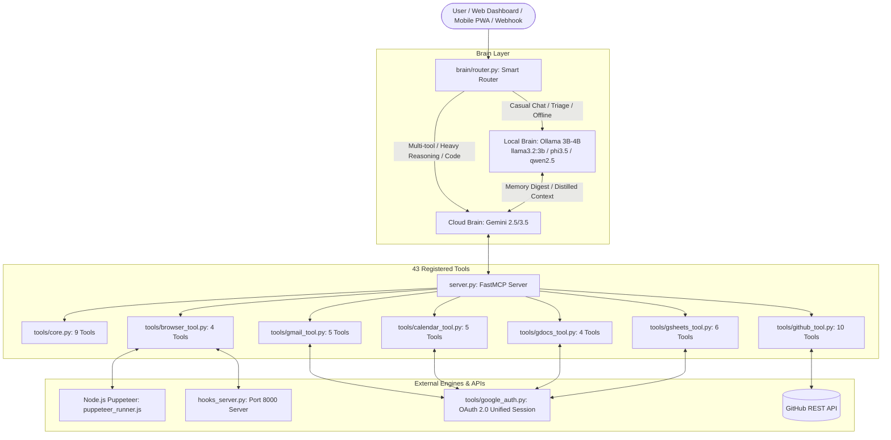

# 🌟 Hope — Autonomous Personal Executive AI Agent

**Hope** is an autonomous personal executive AI agent built on a **Dual-Brain Architecture**:
- ☁️ **Primary Cloud Brain**: Google Gemini 2.5/3.5 (for deep reasoning, code generation, and multi-step tool execution).
- 🧠 **Secondary Local Brain**: Local Ollama model (**`llama3.2:3b`**, **`phi3.5`**, or **`qwen2.5:3b`**) optimized for edge hardware (Intel Core i7-6600U, 8 GB RAM on Debian) for smart query routing, privacy-first local tasks, content distillation, and 100% offline fallback.

Hope operates over **43 FastMCP tools** connecting directly to your everyday productivity stack: **GitHub**, **Gmail**, **Google Calendar**, **Browser Automation (Puppeteer & API Hooks)**, **Google Docs**, and **Google Sheets**.

Access Hope anywhere from your **desktop browser** or **phone** via a modern, smooth, zero-cost **Progressive Web App (PWA)** with **1-click mobile approvals** and **free lock-screen push notifications**.

---

## 📑 Table of Contents

- [⚡ Core Superpowers](#-core-superpowers)
- [🏗️ Dual-Brain Architecture](#️-dual-brain-architecture)
- [🚀 Quick Start](#-quick-start)
  - [On Debian Linux (Laptop)](#on-debian-linux-laptop--intel-core-i7-6600u--8-gb-ram)
  - [On Windows](#on-windows)
- [📱 Executive Web App & Mobile Phone Access](#-executive-web-app--mobile-phone-access)
  - [Access from Phone (100% Free via Tailscale)](#1-access-from-phone-100-free-via-tailscale)
  - [Lock-Screen Push Notifications & 1-Click Approvals (ntfy.sh)](#2-lock-screen-push-notifications--1-click-approvals-ntfysh)
  - [Install as Native App (PWA)](#3-install-as-native-app-pwa)
- [🔑 Step-by-Step Integration Setup](#-step-by-step-integration-setup)
  - [1. Gemini Brain](#1-gemini-brain)
  - [2. Local Brain (Ollama)](#2-local-brain-ollama)
  - [3. GitHub Integration](#3-github-integration-security-fine-grained-token)
  - [4. Google Ecosystem (Unified OAuth for Gmail, Calendar, Docs, Sheets)](#4-google-ecosystem-unified-oauth)
  - [5. Gmail App Password Fallback (IMAP/SMTP)](#5-gmail-app-password-fallback-imapsmtp)
  - [6. Browser Automation (Puppeteer)](#6-browser-automation-puppeteer)
- [🛠️ Tool Suite Reference (43 Tools)](#️-tool-suite-reference-43-tools)
- [🧠 Dual-Brain Routing & Modes](#-dual-brain-routing--modes)
- [🛡️ Security & Human-in-the-Loop Safeguards](#️-security--human-in-the-loop-safeguards)
- [🧪 Testing & Diagnostics](#-testing--diagnostics)
- [📂 Project Directory Structure](#-project-directory-structure)
- [❓ Troubleshooting & FAQ](#-troubleshooting--faq)

---

## ⚡ Core Superpowers

| Service | What Hope Can Do |
| :--- | :--- |
| **🐙 GitHub** | Search code across repos, list & inspect repositories, read/commit files directly, list/create issues, post comments, and manage pull requests. |
| **✉️ Gmail** | Search unread emails, read threads (decoded clean text), send messages to anyone, draft threaded replies, and save Gmail drafts. |
| **📅 Google Calendar** | Inspect daily schedule, schedule meetings with attendees/location, reschedule/update events, delete events, and natural language `quickAdd`. |
| **🌐 Browser Automation** | Full headless or visible Puppeteer web navigation, visual screenshots, interactive form filling (click, type, wait), PDF export, and network API JSON interception. |
| **📄 Google Docs** | Search docs in Google Drive, extract structured document content, create new documents, and append formatted sections. |
| **📊 Google Sheets** | Create spreadsheets, read cell ranges as tables, write/overwrite matrices, append row entries, list tabs, and search spreadsheets. |
| **🧠 Second Brain (Ollama)** | Intent classification, local fast replies with **0 API tokens**, email/page summarization before sending to Gemini, and autonomous memory archiving to `memory.md`. |
| **🪝 Inbound Webhook Server** | Standalone webhook listener on port 8000 handling GitHub push/PR events or custom webhooks to trigger Hope. |
| **📱 Executive Web Dashboard** | Modern, responsive dark-mode PWA with live chat, 1-click approval center, memory editor, and executive morning briefing. |

---

## 🏗️ Dual-Brain Architecture



---

## 🚀 Quick Start

### On Debian Linux (Laptop — Intel Core i7-6600U / 8 GB RAM)

1. **Run the automated setup script**:
   ```bash
   chmod +x setup_debian.sh
   ./setup_debian.sh
   ```
   *This automatically creates a virtual environment, installs Python packages, sets up Node.js & Puppeteer with Chromium dependencies, pulls the lightweight `llama3.2:3b` model into Ollama, and generates `.env`.*

2. **Configure your tokens**:
   ```bash
   nano .env
   ```

3. **Start Hope Web App & API Server**:
   ```bash
   source venv/bin/activate
   python app.py
   ```
   Open **http://localhost:8080** in your browser.

---

### On Windows

1. **Run the PowerShell setup script**:
   ```powershell
   .\setup.ps1
   ```

2. **Configure `.env`**:
   Copy `.env.example` to `.env` if not already created and add your keys.

3. **Start Hope**:
   ```powershell
   python app.py
   ```
   Open **http://localhost:8080** in your browser.

---

## 📱 Executive Web App & Mobile Phone Access

Hope includes a dedicated web application and Progressive Web App (PWA) designed to give you complete executive control from both desktop and phone with **$0.00 spend**.

### 1. Access from Phone (100% Free via Tailscale)
Tailscale creates a secure, encrypted peer-to-peer mesh network between your devices without exposing any ports to the public internet:
1. Install [Tailscale](https://tailscale.com/) on your Debian PC:
   ```bash
   curl -fsSL https://tailscale.com/install.sh | sh
   sudo tailscale up
   ```
2. Install the free **Tailscale** app on your phone (iOS App Store or Google Play) and log into the same account.
3. Check your Debian PC's Tailscale IP (e.g. `100.x.y.z`):
   ```bash
   tailscale ip -4
   ```
4. On your phone, open your browser and navigate to:
   ```text
   http://100.x.y.z:8080
   ```
   *You now have full access to Hope anywhere in the world!*

---

### 2. Lock-Screen Push Notifications & 1-Click Approvals (ntfy.sh)
Hope integrates with [ntfy.sh](https://ntfy.sh) to deliver free real-time push alerts with actionable buttons straight to your phone's lock screen:
1. Choose a unique secret topic name (e.g., `alex-hope-alerts-99x`).
2. Add to `.env`:
   ```env
   NTFY_TOPIC=alex-hope-alerts-99x
   WEB_BASE_URL=http://100.x.y.z:8080
   ```
3. Install the free **ntfy** app on your iOS or Android phone, and subscribe to your topic (`alex-hope-alerts-99x`).
4. Whenever Hope stages a mutating action (email send, commit, PR, event delete), your phone rings with a lock-screen notification containing **[Approve]** and **[Reject]** buttons!

---

### 3. Install as Native App (PWA)
Hope is a fully-configured Progressive Web App:
- **iOS (iPhone/iPad)**: In Safari, tap the **Share** button &rarr; **Add to Home Screen**.
- **Android**: In Chrome, tap the **three dots menu** &rarr; **Install App** or **Add to Home screen**.

Hope launches full-screen with its own icon, app shell caching, and no browser address bar!

---

## 🔑 Step-by-Step Integration Setup

### 1. Gemini Brain
1. Get a free API key at [Google AI Studio](https://aistudio.google.com/).
2. Add to `.env`:
   ```env
   GEMINI_API_KEY=AIzaSy...
   ```

---

### 2. Local Brain (Ollama)
Hope automatically detects installed models via `GET http://localhost:11434/api/tags`.
1. Ensure Ollama is running:
   ```bash
   ollama serve
   ```
2. Pull the recommended 3B model (sized for 8 GB RAM):
   ```bash
   ollama pull llama3.2:3b
   ```
   *(Alternative options supported: `ollama pull phi3.5`, `ollama pull qwen2.5:3b`, or `ollama pull gemma-3-4b`)*.

---

### 3. GitHub Integration (Security: Fine-Grained Token)
1. Go to [GitHub Settings → Personal Access Tokens → Fine-grained tokens](https://github.com/settings/tokens?type=beta).
2. **Repository access**: Select **Only select repositories** (choose only the specific repositories Hope needs). *Do NOT use 'All repositories' or broad classic tokens.*
3. **Permissions**: Grant minimal permissions:
   - `Contents`: Read and write
   - `Pull requests`: Read and write
   - `Issues`: Read and write
4. Add to `.env`:
   ```env
   GITHUB_TOKEN=github_pat_your_fine_grained_token_here
   # (Optional) Enforce repository allowlist for all write tools:
   GITHUB_ALLOWED_REPOS=owner/repo1,owner/repo2
   ```

---

### 4. Google Ecosystem (Unified OAuth)
*A single credentials file authorizes Gmail (read/write), Google Calendar (create/edit), Google Docs, and Google Sheets all at once.*

1. Go to [Google Cloud Console](https://console.cloud.google.com/).
2. Create a project (e.g. `Hope-Agent`).
3. Enable the following APIs in **APIs & Services → Library**:
   - **Gmail API**
   - **Google Calendar API**
   - **Google Docs API**
   - **Google Sheets API**
   - **Google Drive API**
4. Go to **APIs & Services → Credentials**:
   - Click **Create Credentials → OAuth client ID**.
   - Select Application type: **Desktop App**.
   - Download the JSON file and save it as `credentials.json` in the root of the Hope directory.
5. On your first call to any Google tool, a browser window opens automatically. Approve the permissions once — Hope stores the token in `token.json` and refreshes it silently in the future.

---

### 5. Gmail App Password Fallback (IMAP/SMTP)
If you prefer not to set up Google Cloud OAuth:
1. Enable 2-Step Verification in your [Google Account Security](https://myaccount.google.com/security).
2. Create an [App Password](https://myaccount.google.com/apppasswords) for "Mail".
3. Add to `.env`:
   ```env
   GMAIL_ADDRESS=your.name@gmail.com
   GMAIL_APP_PASSWORD=abcd efgh ijkl mnop
   ```

---

### 6. Browser Automation (Puppeteer)
Puppeteer is pre-configured in `package.json`.
1. Install dependencies:
   ```bash
   npm install
   ```
2. Verify browser engine:
   ```bash
   node puppeteer_runner.js test
   ```
3. In `.env`:
   - `PUPPETEER_HEADLESS=true` for silent background execution.
   - `PUPPETEER_HEADLESS=false` if you want to watch the browser navigate and interact visibly!

---

## 🛠️ Tool Suite Reference (43 Tools)

### 🐙 GitHub Tools (`tools/github_tool.py`)
- `github_list_repos(visibility="all", limit=10)` — Lists your repositories with stars and descriptions.
- `github_get_repo_info(repo_name)` — Gets default branch, open issues, stars, forks, and last push date.
- `github_read_file(repo_name, file_path, branch="")` — Reads file contents from any repo branch.
- `github_create_or_update_file(repo_name, file_path, content, commit_message, branch="")` — Commits file changes (requires approval).
- `github_list_issues(repo_name, state="open", limit=10)` — Lists issues with numbers, titles, and labels.
- `github_create_issue(repo_name, title, body="", labels="")` — Opens a new issue.
- `github_comment_issue(repo_name, issue_number, comment)` — Adds a comment to an issue or PR.
- `github_list_prs(repo_name, state="open", limit=10)` — Lists pull requests.
- `github_create_pr(repo_name, title, head, base="main", body="")` — Opens a pull request (requires approval).
- `github_search_code(query, repo="")` — Searches code across GitHub or inside a specific repo.

### ✉️ Gmail Tools (`tools/gmail_tool.py`)
- `gmail_list_messages(query="is:unread", max_results=5)` — Searches emails by query/label.
- `gmail_read_message(message_id)` — Fetches decoded subject, from, to, date, and body.
- `gmail_send_email(to, subject, body)` — Sends an email to any recipient (requires approval).
- `gmail_reply_email(message_id, body)` — Sends a threaded reply (requires approval).
- `gmail_create_draft(to, subject, body)` — Creates a draft in Gmail for manual review.

### 📅 Google Calendar Tools (`tools/calendar_tool.py`)
- `calendar_list_events(days_ahead=7, max_results=15)` — Lists upcoming events with IDs, times, and summaries.
- `calendar_create_event(summary, start_time, end_time, description="", location="")` — Creates calendar events.
- `calendar_update_event(event_id, new_start_time="", new_end_time="", new_summary="", new_description="")` — Reschedules or updates events.
- `calendar_delete_event(event_id)` — Cancels/deletes an event (requires approval).
- `calendar_quick_add(text)` — Natural language event creation (e.g. *"Team lunch tomorrow at 1pm"*).

### 🌐 Browser Automation Tools (`tools/browser_tool.py`)
- `browser_open_and_read(url, wait_selector="")` — Headless page navigation and clean text extraction.
- `browser_take_screenshot(url, filename="screenshot.png")` — Captures webpage screenshots to workspace.
- `browser_interact(url, steps_json)` — Executes click, type, wait, and extract sequences.
- `browser_capture_api(url, api_keyword)` — Intercepts and captures live JSON API requests.

### 📄 Google Docs Tools (`tools/gdocs_tool.py`)
- `gdocs_create_document(title, initial_content="")` — Creates a new Google Doc and returns its URL.
- `gdocs_read_document(document_id_or_url)` — Extracts text from a Google Doc by ID or URL.
- `gdocs_append_text(document_id_or_url, text)` — Appends text to the end of a Google Doc.
- `gdocs_search_documents(query="", max_results=10)` — Searches Google Drive for documents.

### 📊 Google Sheets Tools (`tools/gsheets_tool.py`)
- `gsheets_create_spreadsheet(title, sheet_names="Sheet1")` — Creates a new Google Spreadsheet with tabs.
- `gsheets_read_range(spreadsheet_id_or_url, range_name="A1:Z100")` — Reads cell values into a markdown table.
- `gsheets_write_range(spreadsheet_id_or_url, range_name, values_json)` — Overwrites a cell range with a 2D JSON array.
- `gsheets_append_rows(spreadsheet_id_or_url, range_name, rows_json)` — Appends rows to the end of a sheet.
- `gsheets_get_sheet_names(spreadsheet_id_or_url)` — Lists all tabs, sheet IDs, and row/column counts.
- `gsheets_search_spreadsheets(query="", max_results=10)` — Searches Google Drive for spreadsheets.

### 🧠 Core Tools (`tools/core.py`)
- `search_web(query, max_results=5)` — Web search via DuckDuckGo.
- `fetch_page(url, max_chars=6000)` — Scrapes readable page text with BeautifulSoup/Trafilatura fallback.
- `list_files(folder=".")` — Lists files in `workspace/`.
- `read_file(path, max_chars=8000)` — Reads a text file in `workspace/`.
- `write_file(path, content)` — Writes/overwrites a text file in `workspace/`.
- `remember(note)` — Saves a fact to `workspace/memory.md`.
- `recall()` — Returns long-term memories.
- `current_time()` — Current date and time.
- `send_email_to_me(subject, body)` — Quick email to owner.

---

## 🧠 Dual-Brain Routing & Modes

Hope's dispatcher (`brain/router.py`) dynamically routes queries:
- **`auto` mode (Default)**:
  - *Casual conversations*, greetings, definitions, and memory lookups execute **locally via Ollama** (instant response, 0 API tokens).
  - *Tool actions*, coding, multi-step workflows, and external service requests route to **Gemini + FastMCP**.
- **In-Chat Overrides**:
  - `/local <message>`: Forces local Ollama execution.
  - `/gemini <message>`: Forces Gemini cloud execution.
  - `/status`: Displays an instant health report of all brains and connected integrations.
- **Autonomous Memory Distillation**: When enabled in `config.json`, the local brain runs quietly in a background thread after each chat, extracting lasting preferences about the owner into `workspace/memory.md` without consuming Gemini tokens.

---

## 🛡️ Security & Human-in-the-Loop Safeguards

Hope includes strict safety boundaries to protect your credentials, repositories, and communications:

### 1. Email Draft-Only Mode (`EMAIL_DRAFT_ONLY=true`)
- By default, Hope creates drafts in your Gmail account (`gmail_create_draft`) rather than sending emails directly.
- Emails will never be sent to external recipients without your explicit confirmation.

### 2. Human Approval Gate for Mutating Actions (`REQUIRE_APPROVAL=true`)
- Any high-impact mutating operation:
  - `gmail_send_email` / `gmail_reply_email`
  - `github_create_or_update_file`
  - `github_create_pr`
  - `github_create_issue` / `github_comment_issue`
  - `calendar_delete_event`
- Hope generates a unique action ID (e.g. `act-1a2b`), stages it in `workspace/pending_actions.json`, and alerts your dashboard and mobile lock-screen:
  - In the **Approvals** tab: click **[✓ Approve & Execute]** or **[✕ Reject]**.
  - In chat: reply `yes act-1a2b` or `no act-1a2b`.
  - On phone: tap the **Approve** button directly on the notification!

### 3. Fine-Grained GitHub Tokens & Repository Allowlist
- Hope recommends and requires **Fine-Grained Personal Access Tokens** scoped to specific repositories only.
- Set `GITHUB_ALLOWED_REPOS=owner/repo1,owner/repo2` in `.env` to enforce a hard whitelist against any unauthorized repository writes.

### 4. Localhost-Only Webhook Receiver with HMAC Verification
- `hooks_server.py` binds strictly to `127.0.0.1` (never exposed to public internet without reverse proxy).
- Every incoming GitHub webhook is verified using HMAC-SHA256 (`X-Hub-Signature-256`) against your `GITHUB_WEBHOOK_SECRET`. Unsigned or tampered requests are immediately rejected with `401 Unauthorized`.

### 5. Strict Credential & Cache Ignore Rules
- `.gitignore` strictly covers: `.env`, `credentials.json`, `token.json`, `workspace/`, `venv/`, `.venv/`, and `node_modules/`.
- `token.json` holds OAuth tokens granting access to your Gmail and Google Drive — it is never committed or pushed to Git.

---

## 🧪 Testing & Diagnostics

Run the full automated test suite:
```bash
python -m unittest tests/test_hope.py
```

Check agent status via REST API:
```bash
python -c "import requests; print(requests.get('http://localhost:8080/api/status').json())"
```

Test Puppeteer browser navigation:
```bash
node puppeteer_runner.js test
```

Test Ollama local brain:
```bash
python -c "from brain.local_brain import LocalBrain; b = LocalBrain(); print('Model in use:', b.active_model); print(b.generate('Say ready in 1 word'))"
```

---

## 📂 Project Directory Structure

```text
Hope/
├── app.py                       # Modern FastAPI Web App & REST/SSE Server
├── web/                         # Lightweight, Zero-Build Frontend & PWA
│   ├── index.html               # Responsive executive dashboard
│   ├── styles.css               # Dark-mode glassmorphism styling
│   ├── app.js                   # Vanilla ES6 reactive client
│   ├── manifest.json            # PWA Web App Manifest
│   ├── sw.js                    # Service Worker (offline shell & push alerts)
│   └── icons/                   # App icons (icon.svg, icon-192, icon-512)
│
├── brain/                       # Dual-Brain Layer
│   ├── __init__.py              # Brain package exports
│   ├── local_brain.py           # Ollama integration (discovery, chat, memory distillation)
│   └── router.py                # Smart intent router (heuristics + classifier)
│
├── tools/                       # FastMCP Modular Tools Suite (43 Tools)
│   ├── __init__.py              # Master registry (exports ALL_TOOLS)
│   ├── approval.py              # Human approval gate & mobile push notifications
│   ├── core.py                  # Web search, page fetch, files, memory, time
│   ├── github_tool.py           # GitHub integration (10 tools)
│   ├── gmail_tool.py            # Gmail read/write (5 tools)
│   ├── calendar_tool.py         # Google Calendar create/edit (5 tools)
│   ├── browser_tool.py          # Puppeteer wrapper (4 tools)
│   ├── gdocs_tool.py            # Google Docs & Drive (4 tools)
│   ├── gsheets_tool.py          # Google Sheets integration (6 tools)
│   └── google_auth.py           # Unified Google OAuth 2.0 helper
│
├── workspace/                   # Safe sandbox directory
│   ├── memory.md                # Long-term owner memory notes
│   ├── pending_actions.json     # Staged actions awaiting approval
│   └── webhook_log.jsonl        # Log of received webhook events
│
├── tests/                       # Test Suite
│   └── test_hope.py             # 12 Unit tests (Tools, Brain, Endpoints)
│
├── server.py                    # FastMCP tool server
├── mcp_agent.py                 # Core MCP agent coordinator
├── hooks_server.py              # Inbound webhook receiver (port 8000)
├── puppeteer_runner.js          # Node.js Puppeteer browser automation engine
├── briefing.py                  # CLI Morning executive briefing runner
│
├── setup_debian.sh              # Automated installer for Debian Linux
├── setup.ps1                    # Automated installer for Windows
├── config.json                  # Agent configuration
├── requirements.txt             # Python dependencies
├── package.json                 # Node.js dependencies (Puppeteer)
├── .env.example                 # Environment variables template
├── .gitignore                   # Safe Git ignore rules
└── README.md                    # Comprehensive documentation
```

---

## ❓ Troubleshooting & FAQ

#### Q: How do I pull the latest changes on my other PC without leftover deleted files?
**A**: Run:
```bash
git fetch origin
git reset --hard origin/main
git clean -fd
```
This guarantees your working directory perfectly mirrors the remote repository and removes any deleted files.

#### Q: Will Ollama slow down my laptop (8 GB RAM)?
**A**: No! We deliberately sized Hope for `llama3.2:3b` (~2.2 GB RAM) or `qwen2.5:1.5b` (~1.1 GB RAM). It leaves over 5 GB of RAM completely free for your operating system and web browsing.

#### Q: Google OAuth says "Google hasn't verified this app"
**A**: When creating your Google Cloud OAuth consent screen in testing mode, click **Advanced** and then click **Go to Hope (unsafe)**. This is normal for private personal desktop applications.

#### Q: Puppeteer throws missing libraries error on Debian Linux
**A**: On headless Linux, Chromium requires graphic libraries. Run:
```bash
sudo apt-get install -y libnss3 libatk-bridge2.0-0 libxcomposite1 libxdamage1 libxrandr2 libgbm1 libpango-1.0-0 libcairo2 libasound2
```
*(The `setup_debian.sh` script does this automatically).*

#### Q: What if an integration is missing its API key?
**A**: Hope degrades gracefully. If you ask for GitHub without setting `GITHUB_TOKEN`, Hope will not crash — it will reply with clear step-by-step instructions on how to generate and add the token!
